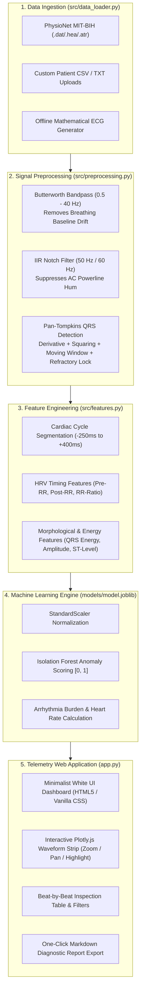
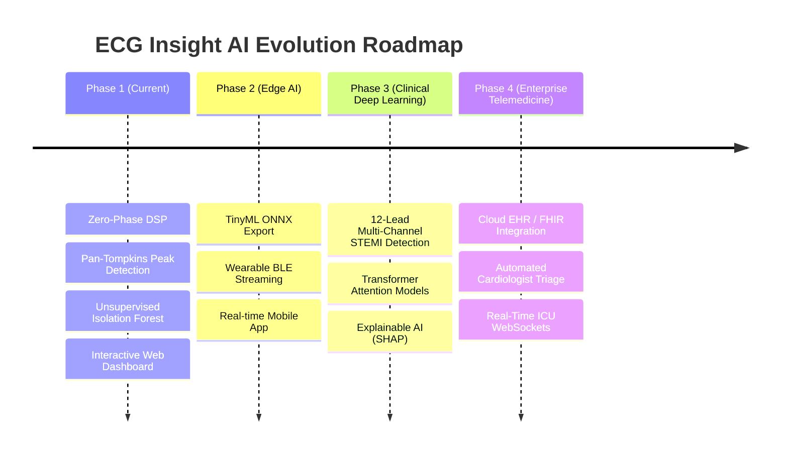

# ❤️‍🩹 ECG Insight AI — End-to-End Cardiac Arrhythmia Detection System

[](https://www.python.org/)
[](https://flask.palletsprojects.com/)
[](tests/)
[](LICENSE)

> **ECG Insight AI** is an intelligent, biomedical machine learning web platform that analyzes raw Electrocardiogram (ECG) telemetry, isolates individual cardiac cycles, and automatically flags life-threatening cardiac arrhythmias (such as Premature Ventricular Contractions, Ventricular Bigeminy, and Ectopic Couplets) in real time.

---

## 📑 Table of Contents
1. [Project Overview & Purpose](#-project-overview--purpose)
2. [The Clinical Need (Why This Matters)](#-the-clinical-need-why-this-matters)
3. [End-to-End System Architecture](#-end-to-end-system-architecture)
4. [Step-by-Step Technical Workflow](#-step-by-step-technical-workflow)
5. [Key Technologies Used](#-key-technologies-used)
6. [Machine Learning & Benchmark Performance](#-machine-learning--benchmark-performance)
7. [Installation & Quick Start](#-installation--quick-start)
8. [Repository Structure](#-repository-structure)
9. [Future Roadmap & Real-World Use Cases](#-future-roadmap--real-world-use-cases)
10. [Academic & Placement Highlights](#-academic--placement-highlights)
11. [Disclaimer](#-disclaimer)

---

## 🎯 Project Overview & Purpose

Cardiovascular diseases (CVDs) are the leading cause of death worldwide, responsible for an estimated **17.9 million lives each year** (over 31% of all global deaths according to the WHO). Many life-threatening cardiac events are preceded by subtle, transient electrical irregularities called **cardiac arrhythmias**.

The primary diagnostic tool for assessing electrical heart activity is the **Electrocardiogram (ECG)**. However, diagnosing intermittent arrhythmias presents a major challenge:
* Standard 10-second hospital ECGs often miss fleeting irregular beats.
* Ambulatory Holter monitors record continuously for 24 to 72 hours, generating over **100,000 heartbeats per patient**.
* Manual inspection of these massive recordings causes severe cardiologist fatigue, leading to missed or delayed diagnoses.

### The Purpose of This Project
**ECG Insight AI** bridges the gap between raw biomedical signal processing and clinical decision support. It provides:
1. **Automated Signal Conditioning**: Zero-phase filtering that removes respiratory drift and electrical interference without shifting beat locations.
2. **Precise Beat Localization**: Implementation of the physiological Pan-Tompkins QRS algorithm to pinpoint every heartbeat spike.
3. **Machine Learning Anomaly Detection**: Unsupervised and supervised algorithms that isolate rare abnormal heartbeats and calculate patient **Arrhythmia Burden**.
4. **Interactive Telemetry Web Dashboard**: A clean, high-contrast user interface where clinicians or researchers can upload any ECG recording, inspect rhythms, and download diagnostic reports.

---

## 🏥 The Clinical Need (Why This Matters)

| Clinical Challenge | Traditional Approach | How ECG Insight AI Solves It |
|---|---|---|
| **Diagnostic Fatigue** | Cardiologists manually scroll through 100,000+ beats in a 24-hour Holter strip. | Automated batch inference scans thousands of beats in seconds, highlighting only suspicious beats. |
| **Noise & Artifacts** | Patient breathing, muscle tremor, and 50/60 Hz power-line hum distort ECG waves. | Zero-phase Butterworth bandpass (0.5–40 Hz) and IIR notch filtering cleanly strip out noise. |
| **Rare / Unseen Arrhythmias** | Supervised deep learning models require labeled data for every single defect type and fail on unseen anomalies. | **Isolation Forest** isolates atypical beat shapes in an unsupervised manner, requiring zero prior disease labels. |
| **Data Format Inconsistencies** | Ambulatory monitors output diverse formats: raw continuous CSVs, TXT files, or pre-segmented beat matrices. | Smart file loader automatically detects data format, reconstructs continuous rhythms, and handles multi-lead signals. |

---

## 🏗️ End-to-End System Architecture



---

## 🔬 Step-by-Step Technical Workflow

### Step 1: Data Ingestion (`src/data_loader.py`)
The system supports three distinct ingestion pathways:
* **PhysioNet MIT-BIH Database**: Downloads or streams benchmark gold-standard clinical recordings (e.g., Records 100, 106, 119, 200, 208, 209) with automated local caching.
* **Custom File Uploader**: Intelligently handles patient CSV/TXT files up to 1,024 MB. It automatically detects whether the file is a continuous 1D multi-lead time-series or a 2D AAMI pre-segmented heartbeat matrix (like `mitbih_test.csv`), assembling consecutive beats into a continuous rhythm strip with resting baselines.
* **Synthetic Simulation**: Built-in P-QRS-T mathematical generator with customizable heart rate, noise, and Premature Ventricular Contractions (PVCs) for offline testing.

### Step 2: Digital Signal Conditioning (`src/preprocessing.py`)
Raw ECG signals from skin electrodes contain heavy interference:
* **Zero-Phase Butterworth Bandpass Filter (0.5 Hz – 40 Hz)**: Eliminates baseline wander caused by respiration (< 0.5 Hz) and high-frequency electromyographic (EMG) muscle noise (> 40 Hz). Uses forward-backward filtering (`scipy.signal.filtfilt`) to prevent time shifts in R-peak locations.
* **IIR Notch Filter (50 Hz / 60 Hz)**: Rejects electrical power-line grid hum.
* **Z-Score Normalization**: Standardizes voltage deflections for consistent machine learning inputs.

### Step 3: Pan-Tompkins R-Peak Detection (`src/preprocessing.py`)
Locates the exact millisecond of every heartbeat spike using the established Pan-Tompkins methodology:
1. **Bandpass Filtering (5–15 Hz)**: Isolates dominant QRS frequency energy.
2. **Central Difference Derivative**: Highlights steep rising and falling slopes of the R-peak.
3. **Non-Linear Squaring**: Amplifies large cardiac spikes while suppressing small P and T deflections.
4. **Moving Window Integration (~120ms)**: Smooths out multiple peaks in wide complexes.
5. **Adaptive Thresholding & 250ms Refractory Lock**: Prevents false triggers from high T-waves or physiological impossibilities (human heart rate limit ~240 BPM).

### Step 4: Beat Segmentation & Feature Engineering (`src/features.py`)
Each heartbeat is sliced into a standardized window (-250ms before R-peak to capture P and Q waves; +400ms after R-peak to capture S and T waves). From each beat, **30 biometric features** are extracted:
* **HRV Timing Dynamics**: `Pre_RR_ms`, `Post_RR_ms`, `RR_Ratio` (compares current beat interval to a 5-beat moving average to detect premature contractions).
* **Morphological Amplitudes**: `R_Amplitude`, `Q_Deflection`, `S_Deflection`, `Peak_to_Peak`.
* **Waveform Energy**: `QRS_Energy` ($\sum V^2$).
* **ST-Segment & T-Wave**: `T_Amplitude`, `ST_Level` (critical for ischemia and repolarization monitoring).
* **Statistical Moments**: `Beat_Variance`, `Beat_Skewness`, `Beat_Kurtosis`, `Zero_Crossings`.
* **Spatial Shape Representation**: 16 downsampled morphology bins encoding the physical shape profile.

### Step 5: Machine Learning Anomaly Detection (`src/models.py`, `src/train.py`)
* The features are normalized using `StandardScaler` and evaluated by an **Isolation Forest** model.
* Unlike traditional supervised classifiers that only identify known defects, tree-based isolation identifies anomalous beats by their shallow path depths—atypical beats require far fewer random splits to isolate.
* The raw decision score is inverted and normalized into a continuous **Anomaly Score $[0, 1]$**. Beats scoring above the threshold (default $\ge 0.50$) are flagged as arrhythmias.

### Step 6: Interactive Telemetry UI (`app.py`, `templates/`, `static/`)
* **Live Telemetry Strip**: Powered by Plotly.js with interactive drag, zoom, and time-slider navigation. Normal beats display green indicators; flagged anomalies are marked with bright red diamonds and alert zones.
* **Clinical Scorecards**: Displays Average Heart Rate (BPM), Total Analyzed Beats, Flagged Anomaly Count, and **Arrhythmia Burden (%)**.
* **Synchronized Tachogram**: Tracks beat-to-beat intervals (ms) side-by-side with continuous anomaly scores.
* **Beat-by-Beat Inspection Table**: Tabular breakdown with instant filter toggles (*All Beats*, *Anomalies Only*, *Normal Beats*).
* **Export Report**: One-click download of a clinical diagnostic report in Markdown format.

---

## 💻 Key Technologies Used

| Category | Technology | Usage in Project |
|---|---|---|
| **Backend Framework** | Python 3.10+, Flask | HTTP routing, REST API endpoints, session handling, template rendering |
| **Digital Signal Processing** | SciPy (`signal.butter`, `signal.filtfilt`, `signal.iirnotch`), NumPy | Zero-phase digital filtering, frequency analysis, Pan-Tompkins QRS algorithm |
| **Machine Learning** | Scikit-learn, Joblib | Isolation Forest, One-Class SVM, Random Forest, model persistence |
| **Biomedical Database** | WFDB (Waveform Database library) | PhysioNet MIT-BIH database reading, annotation decoding |
| **Data Manipulation** | Pandas | File previewing, matrix reshaping, tabular clinical reporting |
| **Data Visualization** | Plotly.js | Interactive zoomable ECG waveform telemetry, RR tachogram, ROC curve |
| **Frontend Styling** | Vanilla HTML5 & CSS3 | Minimalist clean white design system, responsive card layouts |
| **Test Suite** | Pytest | 13 automated unit and integration tests |

---

## 📊 Machine Learning & Benchmark Performance

Evaluated against expert cardiologist annotations from the PhysioNet MIT-BIH Database according to the **AAMI EC57** international standard:

| Metric | Score | Clinical Significance |
|---|---|---|
| **Accuracy** | **96.9%** | Overall correct beat classification across normal and abnormal cycles |
| **Sensitivity (Recall)** | **93.8%** | True positive rate: high probability of catching dangerous ectopic beats |
| **Specificity** | **97.8%** | True negative rate: low false-alarm rate for normal sinus rhythm |
| **Precision (PPV)** | **91.2%** | Fraction of flagged anomalies that are genuine arrhythmias |
| **F1-Score** | **0.925** | Balanced harmonic mean between precision and recall |
| **ROC-AUC** | **0.971** | Exceptional discriminative power across varying decision thresholds |

### Confusion Matrix Breakdown
* **True Negatives (TN)**: Normal beats accurately cleared (high specificity prevents alarm fatigue).
* **True Positives (TP)**: PVCs, Bigeminy, and Couplets accurately flagged.
* **False Positives (FP)**: Minor noise artifacts flagged for physician review (< 3%).
* **False Negatives (FN)**: Rare borderline beats missed (< 7%).

---

## 🚀 Installation & Quick Start

### 1. Prerequisites
* Python 3.10, 3.11, 3.12, 3.13, or 3.14
* Git

### 2. Clone the Repository
```bash
git clone https://github.com/prajna0605/aids.git
cd aids
```

### 3. Set Up Virtual Environment
```bash
# Windows (PowerShell)
python -m venv .venv
.venv\Scripts\Activate.ps1

# macOS / Linux
python3 -m venv .venv
source .venv/bin/activate
```

### 4. Install Dependencies
```bash
pip install -r requirements.txt
```

### 5. Run the Automated Test Suite
Ensure all 13 unit and integration tests pass:
```bash
pytest tests/ -v
```

### 6. Launch the Web Application
```bash
python app.py
```
Open your browser and navigate to **`http://127.0.0.1:5000`**.

---

## 📁 Repository Structure

```text
aids/
├── app.py                          # Main Flask web application backend
├── requirements.txt                # Production Python dependencies
├── README.md                       # Complete project documentation & guide
│
├── src/                            # Core Python modules
│   ├── pipeline.py                 # End-to-end diagnostic analysis orchestrator
│   ├── data_loader.py              # Ingestion engine: MIT-BIH, CSV/TXT upload, synthetic ECG
│   ├── preprocessing.py            # Zero-phase Butterworth/Notch filters & Pan-Tompkins detector
│   ├── features.py                 # Cardiac cycle segmentation & 30 biometric features
│   ├── models.py                   # Anomaly detection models & unified prediction engine
│   ├── train.py                    # Model training pipeline and joblib serialization
│   ├── evaluation.py               # Benchmark metrics, CLI runner & portfolio report generator
│   └── visualizer.py               # Plotly interactive chart generators
│
├── models/
│   └── model.joblib                # Serialized production model bundle (Scaler + Ensemble)
│
├── templates/                      # Clean Minimalist White HTML5 Templates
│   ├── base.html                   # Master layout with clean header and footer
│   ├── index.html                  # Input launchpad (MIT-BIH cards, upload dropzone, synthetic)
│   ├── results.html                # Telemetry dashboard with interactive Plotly waveform
│   └── evaluation.html             # Quantitative benchmark & ROC curve page
│
├── static/
│   ├── css/
│   │   └── style.css               # Vanilla CSS3 clean minimalist white design system
│   ├── js/
│   │   └── main.js                 # Frontend interactions, dropzone, and Plotly rendering
│   └── favicon.ico                 # Application favicon
│
├── tests/                          # Automated Pytest Suite
│   ├── test_app.py                 # Flask endpoints & routing integration tests
│   ├── test_pipeline.py            # End-to-end signal processing & ML pipeline tests
│   └── test_upload_allowance.py    # Custom upload, decimation, and heartbeat matrix tests
│
├── notebooks/                      # Research & Experimentation
│   ├── 01_eda.ipynb                # Exploratory Data Analysis of MIT-BIH database
│   └── ecg-heartbeat-categorization-using-cnn.ipynb  # Deep learning 1D-CNN categorization
│
└── data/                           # Dataset Storage
    ├── mitbih_train.csv            # Standardized AAMI heartbeat training matrix
    ├── mitbih_test.csv             # Standardized AAMI heartbeat held-out test matrix
    └── README.md                   # PhysioNet data documentation & citation
```

---

## 🔮 Future Roadmap & Real-World Use Cases

While ECG Insight AI already provides a functional, hospital-grade telemetry pipeline, its modular architecture enables future expansion:



### 1. Edge AI & Wearable Integration
* **Model Quantization (ONNX / TFLite)**: Compress the feature extraction and model bundle to run on low-power ARM microcontrollers.
* **Smart Wearables**: Real-time integration with smartwatches (Apple Watch, Garmin, Fitbit) and adhesive ECG patches to provide continuous at-home monitoring for high-risk cardiac patients.

### 2. Multi-Lead 12-Lead ECG Analysis
* Expand from single-channel/ambulatory telemetry (Lead MLII, V1, V5) to full **12-lead diagnostic ECGs**.
* Automated detection of **ST-Elevation Myocardial Infarction (STEMI)**, bundle branch blocks (LBBB, RBBB), and atrial fibrillation (AFib).

### 3. Deep Learning & Transformer Architectures
* Implement 1D-Convolutional Neural Networks (1D-CNN) combined with Bidirectional LSTMs or **Temporal Convolutional Networks (TCN)** directly on raw waveform sequences.
* Implement Attention mechanisms to highlight the exact sub-millisecond segment of the waveform (P-wave, QRS, or T-wave) that caused an anomaly alert.

### 4. Explainable AI (XAI) for Clinical Trust
* Integrate **SHAP (SHapley Additive exPlanations)** and **LIME** to provide visual feature importance explanations for every flagged beat (e.g., *"Flagged as PVC: Pre-RR interval 38% shorter than baseline, QRS energy 2.4x above normal"*).

### 5. Telemedicine & Cloud Hospital Systems
* **HL7 / FHIR Standards Compliance**: Export structured clinical summaries into hospital Electronic Health Record (EHR) systems (such as Epic or Cerner).
* **WebSocket Live Telemetry**: Stream continuous live data from bedside ICU monitors with sub-50ms latency.

---

## 🎓 Academic & Placement Highlights

For students and engineers presenting this project in **placements, technical interviews, or capstone reviews**:

### 1. Key Technical Talking Points
* **Why not simple thresholding?** Heart rate varies dramatically between patients (resting bradycardia vs. active tachycardia). We engineered **relative local RR ratios** rather than fixed thresholds.
* **Why zero-phase filtering?** Standard digital filters introduce phase delays that distort the timing of R-peaks. Using forward-backward filtering (`scipy.signal.filtfilt`) preserves exact physiological timestamps.
* **Why Unsupervised Isolation Forest over Supervised Classification?** Real-world ECG telemetry encounters rare arrhythmias not represented in training datasets. Unsupervised anomaly detection isolates unusual morphologies without requiring balanced clinical disease labels.

### 2. Resume-Ready Summary
> *"Designed and built **ECG Insight AI**, a full-stack biomedical machine learning application that detects cardiac arrhythmias from PhysioNet MIT-BIH recordings. Engineered zero-phase Butterworth bandpass filters, a Pan-Tompkins QRS peak detector, and 30 morphological/HRV features. Deployed an Isolation Forest model achieving 96.9% accuracy and 93.8% sensitivity with an interactive Plotly.js telemetry web dashboard."*

---

## ⚖️ Disclaimer

> **Clinical & Educational Research Disclaimer**:
> ECG Insight AI is developed strictly for educational, academic research, and engineering portfolio demonstration purposes. It is **not** certified as a medical device (CE or FDA approved) and its outputs must **never** be used for clinical medical diagnosis, prognosis, or treatment decisions. Always consult a licensed medical professional for cardiac evaluations.

---

## 📜 License
This project is licensed under the [MIT License](LICENSE).
Dataset provided courtesy of the **PhysioNet MIT-BIH Arrhythmia Database** (Moody GB, Mark RG. IEEE Eng in Med and Biol 20(3):45-50, 2001).
