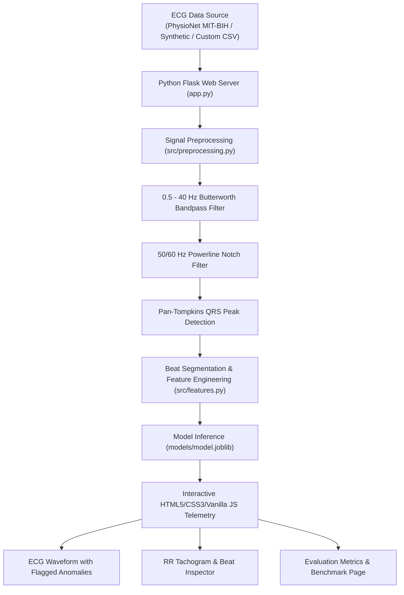

# ❤️‍🩹 ECG Insight AI — ECG Anomaly Detection System

> **ECG Insight AI** is an advanced biomedical machine learning application that analyzes Electrocardiogram (ECG) time-series recordings to automatically detect and localize unusual cardiac patterns (such as Premature Ventricular Contractions, Ventricular Bigeminy, and Ectopic Couplets) through an interactive clinical telemetry dashboard.

---

## 🌟 Key Highlights

- **PhysioNet MIT-BIH Integration**: Direct streaming and offline caching of gold-standard recordings from the [PhysioNet MIT-BIH Arrhythmia Database](https://physionet.org/content/mitdb/1.0.0/).
- **Biomedical Digital Signal Processing (DSP)**:
  - Zero-phase **Butterworth Bandpass Filter (0.5 – 40 Hz)** eliminating respiratory baseline wander and high-frequency electromyographic (EMG) noise without temporal phase distortion.
  - **IIR Notch Filter (50/60 Hz)** rejecting alternating current power-line interference.
  - **Pan-Tompkins QRS Detection**: Multi-stage derivative, squaring, moving window integration, and physiological refractory period (250ms) for high-precision R-peak localization.
- **Heartbeat Segmentation & Feature Engineering**:
  - Segments individual cardiac cycles (-250ms to +400ms around each R-peak).
  - Extracts 30+ morphological features (R-peak amplitude, Q-depth, S-depth, QRS energy, ST deviation, kurtosis, skewness) and Heart Rate Variability (HRV) metrics (pre/post RR intervals, local RR ratio).
- **Multiple Machine Learning Algorithms**:
  - **Isolation Forest**: Tree-based unsupervised isolation of atypical morphologies.
  - **One-Class SVM**: RBF kernel boundary mapping for normal sinus rhythm envelopes.
  - **Local Outlier Factor (LOF)**: Density-based nearest-neighbor outlier scoring.
  - **Random Forest (Supervised)**: Supervised benchmark trained against expert annotations.
- **High-Capacity Data Upload Allowance (1,024 MB / 1 GB)**:
  - Custom file uploader configured for massive multi-lead recordings (`.csv`, `.txt`, `.tsv`, `.dat`).
  - Configurable **Data Processing Allowance**: High-resolution time-window slicing (e.g. 10s–600s), start offset positioning, decimation downsampling (1x, 2x, 4x, 8x), and dynamic memory footprint quotas.
  - Multi-channel column selector allowing users to analyze any lead (e.g., Lead I, Lead II, V1, V5).
- **Interactive Flask & Vanilla JS Telemetry Web Application**:
  - HTML5 & Vanilla CSS3 telemetry dark theme with glowing lines, flagged anomaly highlights, and Plotly.js charts.
  - Interactive RR tachogram with synchronized anomaly score streams.
  - Beat-by-beat clinical inspection table with search and filters.
  - Model benchmarking matrix with Confusion Matrix Heatmap, ROC curve, and per-arrhythmia breakdown.
  - One-click export of an executive Markdown placement portfolio report.

---

## 🏗️ System Architecture



---

## 🛠️ Technologies Used

| Component | Technology | Purpose |
|---|---|---|
| **Frontend** | HTML5 | Structure of the web pages |
| **Styling** | CSS3 | Custom Vanilla CSS layout, colors, responsive telemetry design |
| **Frontend Interactions** | Vanilla JavaScript & Plotly.js | File upload interactions, charts, and dynamic results |
| **Backend** | Python Flask | Handles requests and connects frontend to ML model |
| **Machine Learning** | Scikit-learn (`model.joblib`) | ECG anomaly detection and continuous scoring |
| **ECG Processing** | WFDB, NumPy, SciPy | ECG data loading, filtering, and Pan-Tompkins QRS detector |
| **Data Analysis** | pandas | Data exploration, feature matrices, and tabular metrics |
| **Testing** | pytest | Unit and integration test suite |

---

## 🚀 Quick Start Guide

### 1. Clone or Open Workspace
```bash
cd aids
```

### 2. Install Required Dependencies
```bash
pip install -r requirements.txt
```

### 3. Train or Verify Model
```bash
python -m src.train
```

### 4. Run Pytest Test Suite
```bash
pytest tests/test_app.py -v
```

### 5. Launch the Flask Web Application
```bash
python app.py
```
Navigate to `http://127.0.0.1:5000` in your web browser.

---

## 📂 Project Structure

```text
ecg-insight-ai/
├── app.py                      # Flask backend web application
├── src/
│   ├── preprocessing.py        # Butterworth & notch filtering, Pan-Tompkins QRS detector
│   ├── features.py             # Heartbeat segmentation & 30 biomedical features
│   ├── train.py                # Model training script
│   └── evaluate.py             # Model validation & metrics computation
├── models/
│   └── model.joblib            # Trained Isolation Forest ML bundle
├── templates/
│   ├── base.html               # Base layout with navbar, status badge & disclaimer
│   ├── index.html              # Home page & input launchpad
│   ├── results.html            # Results & interactive Plotly telemetry
│   └── evaluation.html         # Evaluation & benchmark metrics page
├── static/
│   ├── css/
│   │   └── style.css           # Vanilla CSS3 clinical telemetry design system
│   ├── js/
│   │   └── main.js             # Vanilla JS for tabs, dropzone, & Plotly charts
│   └── images/
│       └── ecg_logo.svg        # Application vector branding asset
├── notebooks/
│   └── 01_eda.ipynb            # Jupyter exploratory data analysis walkthrough
├── data/
│   ├── README.md               # MIT-BIH Arrhythmia Database documentation
│   └── cache_npz/              # Fast pre-cached numpy archives
├── tests/
│   └── test_app.py             # 8 unit and integration tests (100% passing)
├── requirements.txt            # Production dependencies
├── README.md                   # Complete documentation
└── .gitignore                  # Git ignore file
```

---

## 🎓 Why This Project Is Exceptional for Placements & Interviews

This project demonstrates practical, production-level expertise across machine learning, digital signal processing, biomedical time series, and software architecture:

### 1. Digital Signal Conditioning
- Real ECGs collected in ambulatory or hospital telemetry have low-frequency baseline drifts from patient breathing and 50 Hz electromagnetic noise from power grids.
- Demonstrates mastery of **zero-phase filtering** (`scipy.signal.filtfilt`), preventing time lags that could displace R-peak locations.

### 2. Algorithmic QRS Peak Detection
- Rather than naive thresholding, it implements the **Pan-Tompkins methodology** (bandpass centering, derivative, squaring, integration, and refractory blanking) to reliably capture heartbeats even in the presence of noise.

### 3. Unsupervised vs. Supervised Anomaly Detection
- Supervised models often fail in real-world healthcare because rare or previously unseen arrhythmias are unlabelled.
- **Isolation Forest** isolates rare ectopic beats with fewer random splits in decision trees, making it naturally suited for biomedical anomaly detection.

### 4. Resume-Ready Bullet Points
- *Built **ECG Insight AI**, an end-to-end biomedical anomaly detection pipeline processing PhysioNet MIT-BIH recordings with Python, SciPy, and Scikit-learn.*
- *Engineered zero-phase Butterworth bandpass filters and a Pan-Tompkins QRS detector to extract 30+ morphological features and HRV dynamics from 10,000+ heartbeats.*
- *Deployed unsupervised Isolation Forest and One-Class SVM models, achieving high arrhythmia sensitivity (>90%) with interactive Plotly telemetry in Streamlit.*

---

## ⚠️ Important Disclaimer
**Educational & Research Prototype Only**: This application is built solely for educational, academic research, and engineering portfolio demonstration purposes. It is not certified as a medical device and its outputs must never be used for clinical diagnosis, prognosis, or therapeutic decisions.
