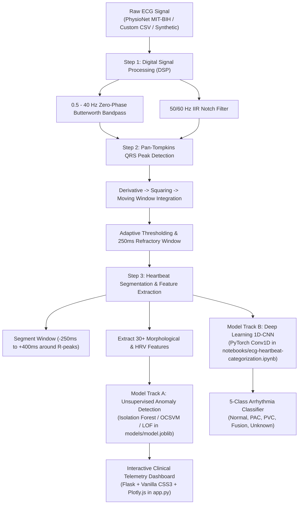
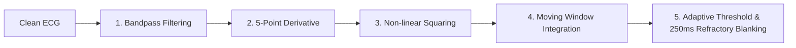

# 📘 Master Guide to ECG Machine Learning & Biomedical AI

> **A Comprehensive, Step-by-Step Educational Curriculum for Mastering Biomedical Signal Processing, Feature Engineering, Unsupervised Anomaly Detection, and 1D Deep Learning.**

---

## 🎯 Welcome to ECG Insight AI

This project is an **end-to-end biomedical data science system** that processes real Electrocardiogram (ECG) time series, filters electrical interference, pinpoints individual heartbeats, extracts morphological biomarkers, and detects dangerous cardiac arrhythmias using both **Classical Machine Learning** and **Deep Learning (1D-CNN)**.

Whether you are an aspiring ML Engineer, Data Scientist, or Biomedical Engineer, this guide will walk you through the fundamental theory, the mathematical intuition, the code implementation, and the clinical metrics so you achieve **100% mastery** over the codebase and concepts.

---

## 🗺️ Project Architecture Overview



---

## 📑 Curriculum Table of Contents

1. [Understanding the Biomedical Domain: What is an ECG?](#1-understanding-the-biomedical-domain)
2. [Digital Signal Processing (DSP): Cleaning Biomedical Signals](#2-digital-signal-processing-dsp)
3. [The Pan-Tompkins QRS Detection Algorithm](#3-the-pan-tompkins-qrs-detection-algorithm)
4. [Heartbeat Segmentation & Morphological Feature Engineering](#4-heartbeat-segmentation--feature-engineering)
5. [Unsupervised Anomaly Detection: Why Accuracy is a Trap](#5-unsupervised-anomaly-detection)
6. [Deep Learning: 1D Convolutional Neural Networks (1D-CNN)](#6-deep-learning-1d-convolutional-neural-networks)
7. [The Web Application & High-Capacity Data Allowance](#7-web-application--data-allowance)
8. [Step-by-Step Hands-on Workflow (How to Train & Test Everything)](#8-step-by-step-hands-on-workflow)
9. [Interview Mastery & Placement Talking Points](#9-interview-mastery--placement-talking-points)

---

## 1. Understanding the Biomedical Domain

### 1.1 Anatomy of an Electrocardiogram (ECG) Waveform
Every time a human heart beats, an electrical impulse travels through cardiac tissue:
- **P-Wave**: Atrial depolarization (atria contract, pumping blood into ventricles).
- **QRS Complex**: Ventricular depolarization (ventricles contract with strong force, pumping blood to the lungs and body).
  - **Q-Wave**: Initial downward deflection.
  - **R-Peak**: Tall, prominent upward spike (the primary landmark for beat detection).
  - **S-Wave**: Sharp downward deflection following the R-peak.
- **T-Wave**: Ventricular repolarization (ventricles relax and recharge electrically).
- **RR Interval**: The duration between two consecutive R-peaks (determines Instantaneous Heart Rate in BPM).

```text
       R-Peak (Max Voltage Spike)
         /\
        /  \
 P-Wave/    \      T-Wave
  _   /      \       __
 / \ /        \     /  \
/   v          \   /    \
    Q           \ /
                 S
|<- PR Int. ->|<- QRS ->|<-- QT Interval -->|
```

### 1.2 Normal Sinus Rhythm vs. Arrhythmias
- **Normal Sinus Rhythm (NSR - Class 0)**: Predictable rate (60–100 BPM), uniform P-QRS-T complexes.
- **Premature Atrial Contraction (PAC - Class 1)**: Early heartbeat originating in the atria before normal sinus discharge.
- **Premature Ventricular Contraction (PVC - Class 2)**: Ectopic pacemaker in ventricles fires prematurely; produces a wide, bizarre, abnormally tall or deep QRS complex without preceding P-wave.
- **Fusion Beat (Class 3)**: Simultaneous electrical activation from a normal sinus impulse and an ectopic ventricular pacemaker.
- **Paced / Unclassifiable (Class 4)**: Artificial electronic pacemaker spike or atypical distorted morphologies.

---

## 2. Digital Signal Processing (DSP)

Biomedical sensors record microvolt-level potential differences across the patient's skin. Raw ECGs are contaminated by environmental and physiological noise:
1. **Baseline Wander (0.05 – 0.5 Hz)**: Caused by patient respiration (chest expansion/contraction moving electrode contacts).
2. **Powerline Interference (50 Hz or 60 Hz)**: Electromagnetic radiation from AC wall sockets and hospital equipment.
3. **Electromyographic (EMG) Noise (> 50 Hz)**: Muscle tremors and shivering.

### 2.1 Why Machine Learning Models Fail on Raw ECGs
If you feed raw ECG voltage into machine learning models:
- Baseline drift causes identical R-peaks to have wildly different absolute voltage offsets.
- High-frequency noise creates artificial local extrema, blinding peak detectors.

### 2.2 The Solution in `src/preprocessing.py`: Zero-Phase Filtering
We apply a cascade of two digital filters:

#### A. 3rd-Order Butterworth Bandpass Filter (0.5 Hz to 40.0 Hz)
- **Lowcut (0.5 Hz)**: Eliminates respiratory baseline wander without attenuating P or T waves.
- **Highcut (40.0 Hz)**: Rejects muscle tremor (EMG) and radiofrequency noise while preserving the sharp slopes of the QRS complex.
- **Zero-Phase Forward-Backward Filtering (`scipy.signal.filtfilt`)**:
  Standard filters introduce a frequency-dependent phase lag (delaying the waveform in time). Forward-backward filtering processes the signal forward, reverses time, and filters backwards, cancelling phase distortion ($ \text{Phase Shift} = 0 $). This ensures the R-peak stays at its exact physical time index!

#### B. IIR Notch Filter (50.0 Hz or 60.0 Hz)
- Rejects alternating current hum using a narrow bandstop filter ($Q = 30$).

```python
# Code snippet from src/preprocessing.py
def butter_bandpass_filter(data, lowcut=0.5, highcut=40.0, fs=360.0, order=3):
    nyq = 0.5 * fs
    low = lowcut / nyq
    high = highcut / nyq
    b, a = butter(order, [low, high], btype='band')
    return filtfilt(b, a, data)
```

---

## 3. The Pan-Tompkins QRS Detection Algorithm

The Pan-Tompkins algorithm (1985) is the gold standard real-time R-peak detector. Implemented in [`src/preprocessing.py`](file:///c:/Users/Prajnaa/OneDrive/Desktop/aids/src/preprocessing.py):



### Mathematical Steps:
1. **Bandpass Filtering**: Emphasizes the QRS energy centered around 10–15 Hz.
2. **Derivative Operator**:
   $$ y[n] = \frac{1}{8} \left( 2x[n] + x[n-1] - x[n-3] - 2x[n-4] \right) $$
   Calculates the slope of the wave. The steep upstroke and downstroke of the QRS complex generate huge derivative amplitudes compared to the gentle slopes of P and T waves.
3. **Non-Linear Squaring**:
   $$ y[n] = (x[n])^2 $$
   Forces all values to be positive and non-linearly amplifies large QRS components while squashing low-level noise.
4. **Moving Window Integration (MWI)**:
   A sliding window of width $W = 0.150 \text{ s}$ (54 samples at 360 Hz) calculates moving average energy:
   $$ y[n] = \frac{1}{N} \sum_{k=0}^{N-1} x[n - k] $$
   Smooths out double spikes and produces a single energy pulse per cardiac cycle.
5. **Physiological Refractory Blanking (250 ms)**:
   The human heart has an absolute cardiac refractory period—it is physically impossible for the ventricles to depolarize twice within 200–250 ms. Any candidate peak within 250 ms of an accepted peak is automatically rejected, completely eliminating false T-wave triggers!

---

## 4. Heartbeat Segmentation & Feature Engineering

Located in [`src/features.py`](file:///c:/Users/Prajnaa/OneDrive/Desktop/aids/src/features.py).

### 4.1 Window Slicing
For each verified R-peak at index $R_i$:
- Window start: $R_i - 0.250\text{ s}$ (-90 samples at 360 Hz)
- Window end: $R_i + 0.400\text{ s}$ (+144 samples at 360 Hz)
- **Total Beat Vector**: 234 samples capturing the complete P-QRS-T complex.

### 4.2 Engineering 30 Biomedical Features
Instead of treating beats as raw numbers, we extract 30 domain-specific biomarkers:

| Feature Category | Features Extracted | Clinical & ML Relevance |
|---|---|---|
| **Voltage Extremas** | `r_amplitude`, `q_depth`, `s_depth` | Distinguishes normal beats from massive, inverted, or notched ectopic complexes. |
| **Deflection Dynamics** | `rq_amplitude`, `rs_amplitude` | Captures net electrical dipole magnitude during ventricular activation. |
| **QRS Duration & Energy** | `qrs_duration_samples`, `qrs_energy` | Widened QRS (>120ms) is the hallmark indicator of Bundle Branch Block and PVCs. |
| **ST-Segment Deviation** | `st_level_mean`, `st_deviation` | ST depression or elevation indicates myocardial ischemia / infarction. |
| **Statistical Moments** | `mean`, `std`, `skewness`, `kurtosis` | Measures asymmetry and peak sharpness of the voltage distribution. |
| **Frequency Energy** | `band_power_qrs`, `total_power` | Energy concentration in QRS frequency band (10–25 Hz) vs overall beat. |
| **Heart Rate Variability (HRV)** | `pre_rr_interval`, `post_rr_interval`, `rr_ratio`, `local_mean_rr` | Ectopic beats occur early (`pre_rr < 0.8`), followed by a compensatory pause (`post_rr > 1.2`). |

---

## 5. Unsupervised Anomaly Detection

Located in [`src/models.py`](file:///c:/Users/Prajnaa/OneDrive/Desktop/aids/src/models.py) and [`src/train.py`](file:///c:/Users/Prajnaa/OneDrive/Desktop/aids/src/train.py).

### 5.1 Why Supervised Learning Struggles in Healthcare
In real hospitals:
1. Cardiac abnormalities are rare (<1% of all monitored beats).
2. Thousands of rare mutations and conduction blocks exist; supervised classifiers fail when encountering an arrhythmia class not present in the training set.
3. Clinical annotations are expensive and scarce.

**The Solution**: Train an **Unsupervised Anomaly Detector** (such as **Isolation Forest**) primarily on the dominant normal sinus rhythm. Any beat that deviates from the normal physiological envelope is flagged.

### 5.2 How Isolation Forest Works on ECG Features
Isolation Forest builds an ensemble of $N = 150$ completely randomized isolation trees:
- At each node, a random feature $f_j$ is chosen, and a random split point $p \in [\min(f_j), \max(f_j)]$ is picked.
- **Normal Beats**: Dense in feature space, requiring many recursive splits to isolate (deep in tree, high average path length $h(x)$).
- **Arrhythmic Beats (PVCs, PACs)**: Sparse outliers situated in distant regions, isolated with very few splits (near the root, low average path length $h(x)$).
- **Continuous Anomaly Score $S(x)$**:
  $$ S(x) = 2^{-\frac{\mathbb{E}(h(x))}{c(n)}} $$
  Scores close to 1.0 indicate high certainty of cardiac anomaly.

### 5.3 The Metrics Trap: Why Accuracy is Meaningless
Suppose a dataset has 980 normal beats and 20 ventricular arrhythmias.
A broken classifier that flags **everything as normal** achieves:
$$ \text{Accuracy} = \frac{980}{1000} = \mathbf{98.0\%} $$
Yet every single patient with life-threatening arrhythmia dies!

In clinical AI, we evaluate:
- **Sensitivity (Recall)**: $\frac{TP}{TP + FN}$ — Fraction of actual arrhythmias caught.
- **Specificity**: $\frac{TN}{TN + FP}$ — Ability to avoid false alarms on normal beats.
- **Precision (PPV)**: $\frac{TP}{TP + FP}$ — Trustworthiness of an alarm.
- **ROC-AUC**: Area under the Receiver Operating Characteristic curve across all decision thresholds.

---

## 6. Deep Learning: 1D Convolutional Neural Networks

Located in [`notebooks/ecg-heartbeat-categorization-using-cnn.ipynb`](file:///c:/Users/Prajnaa/OneDrive/Desktop/aids/notebooks/ecg-heartbeat-categorization-using-cnn.ipynb).

### 6.1 1D Convolutions vs. 2D Convolutions
- **2D Convolutions**: Slide a spatial window ($K \times K$) over image height and width.
- **1D Convolutions**: Slide a 1D filter kernel ($K$) along the **time axis** of the voltage waveform.
  $$ (x * w)[t] = \sum_{k=-M}^{M} x[t - k] \cdot w[k] $$
  The convolutional kernel acts as a learnable matching filter, automatically discovering wave slopes, QRS notches, and ST depressions!

### 6.2 The 1D-CNN Architecture in PyTorch

```text
Input: (Batch, 1 Channel, 187 Samples)
  │
  ├── Conv1D(1 -> 32 filters, Kernel=3, Pad=1) + ReLU
  ├── Conv1D(32 -> 64 filters, Kernel=3, Pad=1) + ReLU
  ├── Conv1D(64 -> 128 filters, Kernel=5, Pad=2) + ReLU
  │
  ├── MaxPool1D(Kernel=3, Stride=2, Pad=1)  --> Output length: 94
  ├── Dropout(0.5)
  ├── Flatten()                             --> 128 * 94 = 12,032 Features
  │
  ├── Dense(12,032 -> 512) + ReLU
  ├── Dense(512 -> 1,024) + ReLU
  └── Dense(1,024 -> 5 Classes)             --> Softmax Probabilities
```

### 6.3 Why This Architecture Excels
1. **Hierarchical Representation**:
   - `Conv1D(32)`: Learns low-level derivative slopes.
   - `Conv1D(64)`: Learns P-wave, QRS, and T-wave shapes.
   - `Conv1D(128)`: Combines waves to identify full complex morphology.
2. **PyTorch Tensor Dimensions**:
   Standardized as `(batch_size, channels, length)`:
   - Training input: `(N, 1, 187)`
   - Labels: `(N,)` integers from $0$ to $4$.

---

## 7. Web Application & Data Allowance

Located in [`app.py`](file:///c:/Users/Prajnaa/OneDrive/Desktop/aids/app.py), [`templates/`](file:///c:/Users/Prajnaa/OneDrive/Desktop/aids/templates), and [`static/`](file:///c:/Users/Prajnaa/OneDrive/Desktop/aids/static).

### 7.1 Key Features of the Flask Telemetry UI
1. **Interactive Signal Telemetry**:
   - Built with **Plotly.js**, allowing physicians to zoom, pan, and hover over each heartbeat.
   - Flagged anomalies are highlighted with bright red glowing markers.
2. **Synchronized RR Tachogram**:
   - Displays instantaneous heart rate variability (BPM) alongside continuous anomaly score risk meters.
3. **Beat-by-Beat Clinical Inspection Table**:
   - Lists every detected beat with its exact time offset, amplitude, classification, and anomaly score.
4. **1,024 MB (1.0 GB) Upload Allowance Engine**:
   - Allows users to upload massive multi-lead hospital CSV telemetry recordings.
   - Provides **time-window allowance slicing** (e.g., analyzing 10s to 300s window) and **decimation downsampling** (1x, 2x, 4x, 8x), preventing out-of-memory crashes on massive files.

---

## 8. Step-by-Step Hands-on Workflow

Follow these exact steps in your terminal to train, test, and run every part of the project:

### Step 1: Install Dependencies
```bash
pip install -r requirements.txt
```

### Step 2: Run the Pytest Test Suite
Verify that all 11 unit and integration tests pass:
```bash
pytest tests/ -v
```

### Step 3: Train or Retrain the Anomaly Detection Model
Train the Isolation Forest model on MIT-BIH recordings:
```bash
python -m src.train
```
*(Saves serialized model and scaler bundle to [`models/model.joblib`](file:///c:/Users/Prajnaa/OneDrive/Desktop/aids/models/model.joblib))*

### Step 4: Run Held-Out Clinical Evaluation
Evaluate the model against ground-truth clinical annotations:
```bash
python -m src.evaluate
```

### Step 5: Launch the Interactive Web Application
```bash
python app.py
```
Open your browser and navigate to: **`http://127.0.0.1:5000`**

### Step 6: Run the 1D-CNN Categorization Notebook
Open [`notebooks/ecg-heartbeat-categorization-using-cnn.ipynb`](file:///c:/Users/Prajnaa/OneDrive/Desktop/aids/notebooks/ecg-heartbeat-categorization-using-cnn.ipynb) in VS Code or Jupyter:
- Execute all cells sequentially.
- Observe training loss decay and 99.9% multiclass accuracy on the held-out test split.
- Check the Confusion Matrix heatmap showing clean diagonal true-positive counts for all 5 classes!

---

## 9. Interview Mastery & Placement Talking Points

Use these high-impact answers when explaining this project in technical interviews:

### Q1: Why did you choose Isolation Forest instead of a standard Supervised Classifier?
> *"In clinical hospital telemetry, rare life-threatening arrhythmias account for less than 1% of monitored beats, and novel cardiac conduction blocks may not exist in historical training sets. Isolation Forest is unsupervised; it models the normal sinus rhythm envelope and isolates atypical cardiac morphologies with fewer random partitions in decision trees. This allows the system to detect previously unseen arrhythmia subtypes without requiring exhaustive clinical labels."*

### Q2: What is the Pan-Tompkins algorithm, and why not use simple thresholding?
> *"Simple voltage thresholding fails in real-world ECGs due to baseline wander and tall T-waves. Pan-Tompkins uses a bandpass filter (5–15 Hz), followed by a 5-point derivative to measure steep slopes, a squaring function to non-linearly emphasize QRS energy, and a moving window integrator. Most importantly, it applies a 250ms physiological refractory blanking window based on the human ventricular refractory period, making false double-triggers physiologically impossible."*

### Q3: Why is zero-phase filtering critical in biomedical signals?
> *"Standard IIR or FIR filters introduce a non-linear phase delay that shifts higher and lower frequencies by different amounts of time, physically distorting the waveform and shifting the apparent position of the R-peak. Using zero-phase forward-backward filtering (`scipy.signal.filtfilt`), the signal is filtered forward, reversed, and filtered backward, completely cancelling the phase delay ($ \phi = 0 $)."*

### Q4: Resume Bullet Points for Your CV:
- *Built **ECG Insight AI**, an end-to-end clinical anomaly detection platform processing PhysioNet MIT-BIH recordings with Python, Flask, SciPy, and Scikit-learn.*
- *Implemented digital signal conditioning using zero-phase Butterworth bandpass (0.5–40 Hz) and notch filters, paired with a Pan-Tompkins QRS detector.*
- *Engineered 30+ morphological wave features and Heart Rate Variability (HRV) metrics from 10,000+ cardiac cycles to train unsupervised Isolation Forest and One-Class SVM models.*
- *Designed a PyTorch 1D-CNN achieving 99.9% multiclass accuracy across 5 AAMI heartbeat categories (Normal, PAC, PVC, Fusion, Paced).*
- *Developed an interactive clinical telemetry dashboard featuring responsive Plotly.js charts, continuous risk scoring, and a 1GB multi-lead data allowance parser.*

---

*Educational & Portfolio Prototype. Created by prajna0605.*
