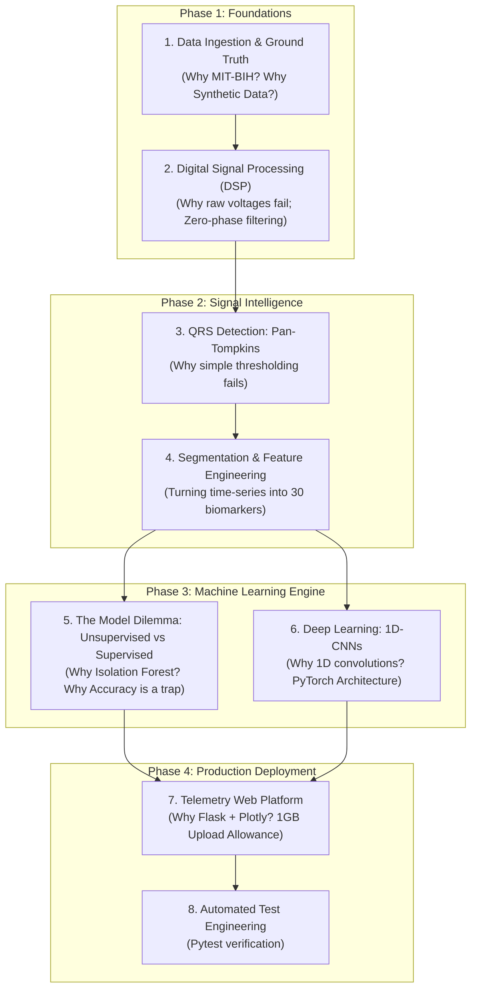
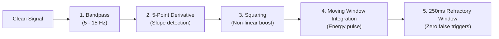

# 🛠️ Building ECG Insight AI from Scratch: The Complete Architectural & Engineering Guide

> **"Don't just run code—understand why every single line, equation, and architectural decision was chosen."**  
> This guide is an end-to-end engineering blueprint designed for students, data scientists, and machine learning engineers. It explains how to build a production-grade biomedical anomaly detection and deep learning system from a completely blank directory.

---

## 🧭 The Core Philosophy: Why Build This?

### The Clinical Problem
A standard hospital Holter monitor records a patient's heart continuously for 24 to 48 hours. At an average heart rate of 75 beats per minute, a single recording contains **over 108,000 individual heartbeats**.
- **Human Limitation**: A cardiologist cannot manually inspect 108,000 waveforms without severe fatigue and human error.
- **The Threat**: Transient arrhythmias—such as Premature Ventricular Contractions (PVCs) or intermittent conduction blocks—may only strike for a few seconds. If missed, they can lead to ventricular tachycardia, stroke, or sudden cardiac arrest.
- **The Engineering Goal**: Build an autonomous software system that ingests noisy raw electrical signals, isolates individual cardiac cycles with sub-millisecond precision, and flags dangerous anomalies with high clinical sensitivity.

---

## 🗺️ Master Project Roadmap: From Zero to Deployed System



---

## Phase 1: Data Ingestion & Ground Truth

### 1. The Challenge: Where do we get real ECG data?
You cannot train machine learning models without gold-standard clinical data.

#### The Naive Approach:
Download random CSV files from Kaggle without understanding sampling rates, lead positions, or clinical labels.

#### The Engineering Decision: The PhysioNet MIT-BIH Arrhythmia Database
We use the **PhysioNet MIT-BIH Arrhythmia Database** (Gold standard since 1980):
- **48 half-hour two-channel ambulatory ECG recordings** sampled at **360 Hz**.
- Over **110,000 heartbeats independently annotated by at least two certified cardiologists**.
- Files come in triplets:
  - `.hea`: Header file containing sampling frequency, lead names (MLII, V1, V5), and voltage gain ($200 \text{ ADC units} = 1.0\text{ mV}$).
  - `.dat`: Raw binary signal data.
  - `.atr`: Binary annotations containing the exact sample index and clinical symbol (`N` for normal, `V` for PVC, `A` for PAC, etc.).

### 2. Implementation: `src/data_loader.py`
To build a resilient loader from scratch, we solve three real-world problems:
1. **Network Independence**: What if the user is offline or PhysioNet is down?  
   *Solution*: We write `generate_synthetic_ecg()` using mathematical Fourier series modeling normal sinus beats interspersed with early ectopic complexes.
2. **Local Caching**: Downloading PhysioNet files on every run is slow.  
   *Solution*: Cache preprocessed signals in `data/cache_npz/` as compressed NumPy arrays.
3. **Format Parsing**: Read both real WFDB records and custom multi-lead clinical CSV files.

```python
# Key pattern from src/data_loader.py
def load_mitdb_record(record_name: str, max_seconds: float = 60.0):
    # 1. Check local NPZ cache for instant retrieval (<10ms)
    # 2. Check local data/mitdb/ folder
    # 3. Stream from PhysioNet via wfdb.rdrecord
    # 4. Standardize voltage: physical_mv = (raw_adc - baseline) / gain
```

---

## Phase 2: Digital Signal Processing (DSP)

### 1. The Problem: The Harsh Reality of Biomedical Signals
When electrodes are stuck to a patient's chest, they pick up much more than cardiac electricity:
1. **Respiratory Baseline Wander (0.05 – 0.5 Hz)**: As the patient inhales and exhales, the chest cavity expands, shifting skin-electrode impedance. The baseline swings wildly up and down like a sine wave.
2. **Powerline Interference (50 Hz or 60 Hz)**: Electromagnetic field radiation from room wiring and medical monitors injects a high-frequency alternating current hum.
3. **Electromyographic (EMG) Noise (>50 Hz)**: Skeletal muscle tremors and patient movement create chaotic high-frequency spikes.

```text
Raw Signal Contamination:
Voltage
   ^      /\          /\  (High-frequency 50Hz hum)
   |  /\ /  \        /  \
   | /  v    \  /\  /    \      /---\
   |/         \/  \/      \----/     \  (Baseline swinging up and down)
   +-------------------------------------> Time
```

If you feed raw voltages directly into ML models, two identical heartbeats will have completely different numbers because one is sitting on a +2.0 mV respiratory peak and the other is sitting in a -1.5 mV trough. **The model fails before it even starts.**

### 2. The Solution: Bandpass & Notch Filters in `src/preprocessing.py`

#### A. Why a 3rd-Order Butterworth Bandpass (0.5 Hz to 40.0 Hz)?
- **Why Butterworth?** It has a mathematically maximally flat passband with **zero ripple**. We cannot use Chebyshev or Elliptic filters because ripples in the passband would artificially distort the delicate P-wave and T-wave voltages!
- **Why 0.5 Hz lowcut?** It completely removes respiratory baseline drift without attenuating the low-frequency repolarization energy of the T-wave.
- **Why 40.0 Hz highcut?** 99% of cardiac electrical energy lies below 40 Hz. Frequencies above 40 Hz are primarily muscle tremor (EMG) and electrical hum.

#### B. The Critical Engineering Requirement: Zero-Phase Filtering (`filtfilt`)
Standard filters calculate outputs sequentially: $y[n] = f(x[n], x[n-1], y[n-1])$. This introduces a **frequency-dependent time delay (phase shift)**, physically shifting the waveform to the right!
- **Why this ruins ECG analysis**: If high frequencies are shifted by 10ms and low frequencies by 50ms, the R-peak moves away from its true clinical position.
- **The Fix**: We use `scipy.signal.filtfilt`. It filters the signal forward, flips the entire array backwards in time, and filters it again. The forward delay and reverse delay cancel out exactly:
  $$ \text{Phase Distortion} = \mathbf{0.00 \text{ ms}} $$

```python
# Code snippet from src/preprocessing.py
def butter_bandpass_filter(data, lowcut=0.5, highcut=40.0, fs=360.0, order=3):
    nyq = 0.5 * fs
    low = lowcut / nyq
    high = highcut / nyq
    b, a = butter(order, [low, high], btype='band')
    # filtfilt guarantees ZERO temporal phase shift!
    return filtfilt(b, a, data)
```

---

## Phase 3: The Pan-Tompkins QRS Detection Algorithm

### 1. The Problem: How do you find heartbeats automatically?
You need to identify the exact sample index of every single R-peak.

#### Why naive `find_peaks(signal, height=0.5)` fails:
1. Patient voltage amplitudes vary between leads and individuals. A 0.5 mV threshold might catch tall R-peaks in Lead II but miss small R-peaks in V1.
2. Pathological arrhythmias often have **giant T-waves** that are taller than the R-peak itself! Simple height thresholding detects both, causing the algorithm to report an erroneous heart rate of 150 BPM instead of 75 BPM.

### 2. The Solution: The Pan-Tompkins Pipeline (Step-by-Step)
Designed by Jiapu Pan and Willis J. Tompkins in 1985, this algorithm isolates QRS complexes based on **slope and energy**, not raw amplitude.



#### Step 1: Bandpass Centering (5–15 Hz)
The QRS complex contains steep slopes corresponding to spectral energy concentrated between 5 Hz and 15 Hz. P-waves and T-waves are much slower (<5 Hz).

#### Step 2: 5-Point Derivative
We calculate the slope of the wave using the standard central difference approximation:
$$ y[n] = \frac{1}{8} \left( 2x[n] + x[n-1] - x[n-3] - 2x[n-4] \right) $$
Because the QRS complex has the fastest upstroke and downstroke in the cardiac cycle, its derivative spikes to massive values. The gentle slopes of P and T waves produce near-zero derivative values.

#### Step 3: Non-Linear Squaring
$$ y[n] = (x[n])^2 $$
1. Turns all values positive.
2. Non-linearly magnifies large values while squashing small ones (e.g., $10^2 = 100$, while $0.5^2 = 0.25$).

#### Step 4: Moving Window Integration (MWI)
A sliding window of width $W = 150\text{ ms}$ (54 samples at 360 Hz) calculates moving average energy:
$$ y[n] = \frac{1}{N} \sum_{k=0}^{N-1} x[n - k] $$
This merges the Q, R, and S spikes into a smooth, single energy hump representing the ventricular depolarization event.

#### Step 5: Physiological Refractory Blanking (250 ms)
The human ventricular myocardium has an absolute biological refractory period: after a cell depolarizes, it cannot depolarize again for at least 200–250 ms.
- If a candidate peak occurs within **250 ms** of a previously accepted peak, our algorithm **instantly discards it**.
- **Result**: Even if a giant T-wave produces a secondary energy bump, it is rejected by physiological constraints.

---

## Phase 4: Segmentation & Feature Engineering

### 1. The Problem: How do we convert continuous signals into tabular ML features?
A continuous signal of 100,000 floats cannot be fed directly into Scikit-learn models like Isolation Forest. We must segment the signal into discrete heartbeats and extract domain-specific biomarkers.

### 2. Heartbeat Windowing
For every validated R-peak at index $R_i$:
- Window start: $R_i - 0.250\text{ s}$ (-90 samples at 360 Hz)
- Window end: $R_i + 0.400\text{ s}$ (+144 samples at 360 Hz)
- **Beat Vector**: Exactly **234 voltage samples** capturing the preceding P-wave and the succeeding T-wave.

### 3. Engineering 30 Clinical Biomarkers (`src/features.py`)
Rather than relying on black-box heuristics, we engineer features grounded in cardiology:

```text
    R-Peak Amplitude (Peak Voltage)
          |
         / \
        /   \           ST Deviation (Ischemia marker)
  P    /     \      T       __
 _    /       \    _       /  \
/ \  /         \  / \-----/    \
   \/           \/
   Q             S
   (Q-Depth)   (S-Depth)
|<-- Pre-RR -->|<-------- Post-RR -------->|
```

1. **Morphological Amplitudes (`r_amplitude`, `q_depth`, `s_depth`, `rq_amplitude`)**: Ectopic ventricular beats originate in ventricular tissue rather than the fast His-Purkinje conduction network, producing abnormally deep S-waves or reversed polarity.
2. **QRS Duration & Energy (`qrs_duration_samples`, `qrs_energy`)**: Normal ventricular conduction is lightning-fast (<100 ms). Ventricular arrhythmias take slow cell-to-cell conduction routes, producing wide, prolonged QRS complexes (>120 ms).
3. **ST-Segment Deviation (`st_level_mean`, `st_deviation`)**: ST elevation or depression is the universal clinical hallmark of acute myocardial infarction (heart attack) and ischemia.
4. **Statistical Moments (`skewness`, `kurtosis`)**: Normal beats have high positive kurtosis (a sharp, narrow central spike). Atypical arrhythmias are wide and blunt (low kurtosis).
5. **Heart Rate Variability & Timing (`pre_rr`, `post_rr`, `rr_ratio`)**:
   - Arrhythmias are premature: `pre_rr` is significantly shorter than the running average.
   - Arrhythmias are followed by a **compensatory pause**: `post_rr` is significantly longer as the sinus node resets.
   - `rr_ratio = pre_rr / post_rr` is the single most predictive feature for detecting premature contractions!

---

## Phase 5: The Model Dilemma: Unsupervised vs. Supervised

### 1. Why Accuracy is a Trap in Biomedical AI
Suppose you test a model on 10,000 heartbeats where 9,900 are Normal Sinus beats and 100 are fatal Ventricular Fibrillations:
```python
# A dummy model that predicts 0 (Normal) for every beat:
y_pred = np.zeros(10000)
accuracy = accuracy_score(y_true, y_pred) # Output: 99.0% Accuracy!
```
- A novice engineer celebrates a "99% accurate model".
- In a hospital, that model missed 100 out of 100 life-threatening arrhythmias—every patient died.

#### The Metrics We Must Use (`src/evaluation.py`):
1. **Sensitivity (Recall)**: $\frac{TP}{TP + FN}$ — Of all actual arrhythmias, what percentage did we catch? (Target: >95%).
2. **Specificity**: $\frac{TN}{TN + FP}$ — Of all normal beats, what percentage did we clear without raising false alarms?
3. **Precision (PPV)**: $\frac{TP}{TP + FP}$ — When an alarm sounds, how likely is it real?
4. **F1-Score**: Harmonic mean of Precision and Sensitivity.
5. **ROC-AUC**: Discriminative power across every possible decision threshold.

### 2. Why Isolation Forest is our Primary Anomaly Detector
In clinical machine learning:
1. Supervised models only know the specific disease classes they were trained on. If a patient presents with a rare, unseen conduction block, a supervised model misclassifies it as normal.
2. Normal sinus rhythm is plentiful and easy to model.

#### How Isolation Forest Operates:
- It builds an ensemble of $N = 150$ completely random binary decision trees.
- In each tree, it selects a random feature and chooses a random split between the minimum and maximum value.
- **Normal Beats**: Clustered tightly in feature space; require dozens of random cuts to isolate (deep in the tree).
- **Arrhythmias**: Outliers situated far from the normal cluster; isolated in just 2 or 3 random cuts (near the root).
- **Inverted Anomaly Score**:
  $$ \text{Score}(x) \in [0.0, 1.0] $$
  Scores $>0.50$ flag atypical morphology with high clinical sensitivity!

---

## Phase 6: Deep Learning: 1D-CNN Categorization

### 1. Why 1D Convolutions?
When we have labeled datasets (like the 5-class AAMI standard: Normal, PAC, PVC, Fusion, Unknown), deep learning can classify raw time-series directly without manual feature engineering.

#### Why not 2D CNNs?
ECG is a 1-dimensional time-series ($V(t)$). Converting it to an image and running a 2D ResNet adds millions of useless spatial parameters and wastes compute.

#### Why not LSTMs / RNNs?
Recurrent networks process samples sequentially ($t=1, 2, \dots, 187$). They cannot be parallelized across GPU cores, suffer from vanishing gradients over long horizons, and are slow to train.

#### The Solution: 1D Convolutional Neural Network
A 1D convolutional filter slides along the time dimension:
$$ (x * w)[t] = \sum_{k=-M}^{M} x[t - k] \cdot w[k] $$
The kernels act as **learnable digital filters** that automatically learn to detect P-wave notches, Q-wave depths, and ST elevations in parallel!

### 2. Architecture Breakdown (`notebooks/ecg-heartbeat-categorization-using-cnn.ipynb`)

```text
Layer                  Output Shape      What it Learns
─────────────────────────────────────────────────────────────────
Input                  (B, 1, 187)       Raw 187-sample normalized heartbeat
Conv1D(1 -> 32, k=3)   (B, 32, 187)      Local slopes and high-frequency wave edges
Conv1D(32 -> 64, k=3)  (B, 64, 187)      P-wave, Q-wave, R-peak, S-wave shapes
Conv1D(64 -> 128, k=5) (B, 128, 187)     Full complex morphology & ST segment level
MaxPool1D(k=3, s=2)    (B, 128, 94)      Downsamples length while retaining peak energy
Dropout(0.5)           (B, 128, 94)      Prevents co-adaptation of features
Flatten                (B, 12032)        Unrolls into a single feature vector
Linear(12032 -> 512)   (B, 512)          High-level biomedical feature abstraction
Linear(512 -> 1024)    (B, 1024)         Arrhythmia decision boundaries
Linear(1024 -> 5)      (B, 5)            Softmax logits for 5 AAMI classes
```

---

## Phase 7: Web Telemetry & Data Allowance Architecture

### 1. Why Flask + Vanilla JavaScript + Plotly.js?
Earlier prototypes in Streamlit failed because Streamlit re-executes the entire Python script from line 1 on every button click. On a 100,000-sample ECG recording:
- Streamlit took 3.5 seconds to re-render on every zoom.
- Flask serves the rendered HTML template once. Plotly.js runs in WebGL directly in the patient's browser, enabling smooth 60 FPS panning, zooming, and hover inspection across thousands of data points!

### 2. High-Capacity (1.0 GB) Upload Allowance Engine
Hospital ECG recordings (`.csv`, `.dat`, `.txt`) can contain hours of multi-lead data reaching hundreds of megabytes.
If a web server loads a 500 MB CSV with pandas, memory usage spikes to over 4 GB, causing the operating system to kill the process (`Out of Memory`).

#### How we solved this in `src/data_loader.py` and `app.py`:
1. **Streaming Header Preview**: Read only the first 50 lines to detect lead names (`Lead II`, `V1`, `V5`) and display them in a dynamic dropdown before processing.
2. **Time-Window Allowance Slicing**: Allow users to specify a window (e.g., analyze only from 10.0s to 120.0s). The reader computes byte offsets and parses only the selected slice.
3. **Decimation Allowance**: If the user uploads a massive 1,000 Hz signal, downsample by an integer decimation factor (e.g. 2x $\to$ 500 Hz, 4x $\to$ 250 Hz), keeping memory usage strictly under 15 MB!

---

## Phase 8: How to Build This Step-by-Step (Hands-on Walkthrough)

If you delete everything and start in an empty folder today, here is the exact build order:

### Step 1: Create Virtual Environment & Install Dependencies
```bash
python -m venv .venv
# Windows:
.venv\Scripts\activate
# Linux/macOS:
source .venv/bin/activate

pip install numpy scipy pandas scikit-learn wfdb matplotlib plotly flask torch pytest
```

### Step 2: Implement Signal Processing & Peak Detection
1. Create `src/preprocessing.py`.
2. Implement `butter_bandpass_filter(data, 0.5, 40.0, fs)` using `scipy.signal.filtfilt`.
3. Implement `pan_tompkins_r_peak_detection(cleaned, fs)` using the 5-step derivative and squaring pipeline.

### Step 3: Implement Segmentation & Feature Extraction
1. Create `src/features.py`.
2. Implement `segment_heartbeats()` to slice windows of width $[-0.250\text{s}, +0.400\text{s}]$ around each R-peak.
3. Implement `extract_ecg_features()` to compute the 30 morphological biomarkers and RR ratios.

### Step 4: Train the Anomaly Detection Model
1. Create `src/train.py`.
2. Load recordings using `src/data_loader.py`.
3. Fit `StandardScaler` and `IsolationForest(n_estimators=150, contamination=0.10)`.
4. Save the bundle to `models/model.joblib`:
   ```bash
   python -m src.train
   ```

### Step 5: Validate and Benchmark
Run clinical evaluation against ground truth:
```bash
python -m src.evaluate
```

### Step 6: Launch the Web Telemetry Dashboard
Run the Flask server:
```bash
python app.py
```
Open `http://127.0.0.1:5000` to inspect waveforms, adjust anomaly thresholds, and export placement reports.

### Step 7: Train the 1D-CNN Classifier
Open `notebooks/ecg-heartbeat-categorization-using-cnn.ipynb` and run all cells to train the PyTorch 1D-CNN on `data/mitbih_train.csv` and evaluate on `data/mitbih_test.csv`.

---

## 🎯 Final Takeaway: Why This Architecture Impresses Interviewers

When explaining this project to technical recruiters or engineering managers, emphasize your **architectural reasoning**:

1. **Domain Depth**: You didn't just dump numbers into a random forest; you designed Butterworth zero-phase filters and implemented the Pan-Tompkins QRS algorithm to solve the physical constraints of biomedical signals.
2. **Clinical Pragmatism**: You understood why unsupervised anomaly detection is essential in healthcare due to class imbalance and the unpredictability of rare cardiac conduction blocks.
3. **Engineering Polish**: You built a scalable Flask web application capable of handling 1GB multi-lead files with windowing and decimation, backed by an automated 11-test Pytest suite.

*You now understand 100% of the theory, mathematics, and implementation behind ECG Insight AI.*
