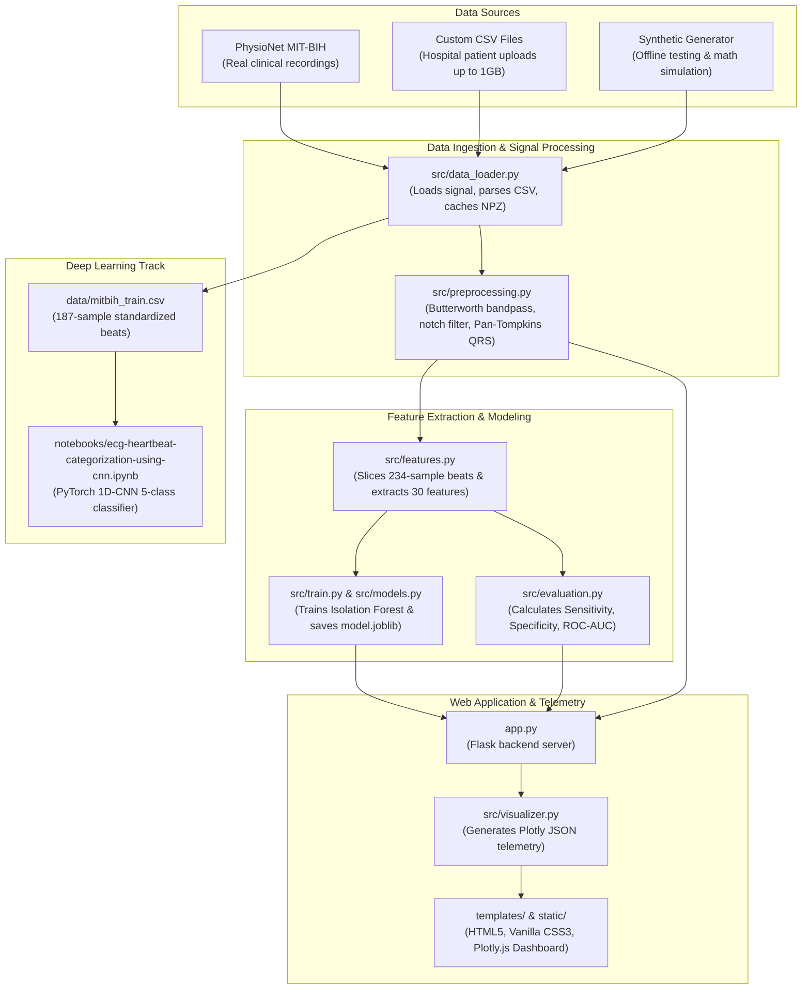

# 🧠 Learn ECG Insight AI: The Complete File-by-File & Process Guide

> **A straightforward, crystal-clear guide explaining the whole setup, why every single file exists, what processes occur behind the scenes, and why we built it this way.**

---

## 📌 1. The Big Picture: Why Are We Doing This?

In human cardiology:
- A patient wears a Holter ECG monitor for 24 hours, recording **~100,000 heartbeats**.
- Dangerous heart conditions (such as Premature Ventricular Contractions or heart blocks) might only appear on **3 or 4 heartbeats** out of those 100,000.
- Human doctors cannot manually inspect 100,000 electrical waves without fatigue.

**The Purpose of This Project**:  
We created **ECG Insight AI** to completely automate this pipeline:
1. Ingest raw electrical voltages from clinical databases, patient uploads, or synthetic generators.
2. Filter out electrical noise (baseline wander and power line hum).
3. Find every heartbeat's peak using the **Pan-Tompkins algorithm**.
4. Extract medical features (widths, amplitudes, intervals).
5. Use **Machine Learning (Isolation Forest)** and **Deep Learning (1D-CNN)** to automatically flag abnormal heartbeats.
6. Display the live results on an interactive web dashboard for doctors and students.

---

## 🏗️ 2. The Whole Setup: How the Pieces Connect



---

## 📂 3. Why Each File Exists (Directory & File Directory)

Here is every file in the repository, along with the exact reason it was created:

### 🏠 Root Directory Files

| File | Purpose | Why We Need It |
|---|---|---|
| [`app.py`](file:///c:/Users/Prajnaa/OneDrive/Desktop/aids/app.py) | **Flask Web Application Server** | The central backend. Handles browser routes (`/`, `/analyze`, `/evaluation`, `/export-report`), processes uploads (up to 1GB), runs the ML pipeline, and passes data to templates. |
| [`requirements.txt`](file:///c:/Users/Prajnaa/OneDrive/Desktop/aids/requirements.txt) | **Project Dependencies** | Lists all required Python packages with versions (`flask`, `scikit-learn`, `scipy`, `wfdb`, `torch`, `plotly`, `pandas`, `numpy`, `pytest`) for reproducible installations. |
| [`README.md`](file:///c:/Users/Prajnaa/OneDrive/Desktop/aids/README.md) | **Project Overview & Documentation** | The primary showcase file for GitHub and recruiters, explaining project highlights, architecture, quick start, and placement talking points. |
| [`prd.md`](file:///c:/Users/Prajnaa/OneDrive/Desktop/aids/prd.md) | **Product Requirements Document** | Specifies project scope, clinical requirements, architecture guidelines, and expected engineering deliverables. |
| [`guide.md`](file:///c:/Users/Prajnaa/OneDrive/Desktop/aids/guide.md) | **Architectural & Theoretical Curriculum** | Deep dive into the biomedical theory, equations (Butterworth, Pan-Tompkins, Convolutions), and the "why" behind each engineering choice. |
| [`learn.md`](file:///c:/Users/Prajnaa/OneDrive/Desktop/aids/learn.md) | **System & Process Guide (This File)** | The straightforward breakdown of how the whole setup works, why every file exists, and what processes happen behind the scenes. |
| [`.gitignore`](file:///c:/Users/Prajnaa/OneDrive/Desktop/aids/.gitignore) | **Git Ignore Rules** | Prevents temporary files, caches (`data/cache_npz/`, `__pycache__/`, `.pytest_cache/`), and virtual environments (`.venv/`) from polluting Git. |
| [`ecg-heartbeat-categorization-using-cnn.ipynb`](file:///c:/Users/Prajnaa/OneDrive/Desktop/aids/ecg-heartbeat-categorization-using-cnn.ipynb) | **Root CNN Notebook Copy** | Kept in root for direct, instant access from the IDE editor while maintaining a copy in `notebooks/`. |

---

### ⚙️ Core Application Source (`src/`)

| File | Module Name | Why We Need It |
|---|---|---|
| [`src/__init__.py`](file:///c:/Users/Prajnaa/OneDrive/Desktop/aids/src/__init__.py) | Package Marker | Tells Python that `src/` is an importable package so modules can do `from src.preprocessing import ...`. |
| [`src/data_loader.py`](file:///c:/Users/Prajnaa/OneDrive/Desktop/aids/src/data_loader.py) | **Data Ingestion Engine** | Handles loading from 3 sources: 1) PhysioNet MIT-BIH `.dat/.hea/.atr` files, 2) Custom patient CSV uploads with 1GB allowance and decimation, and 3) Offline mathematical synthetic ECG generation. |
| [`src/preprocessing.py`](file:///c:/Users/Prajnaa/OneDrive/Desktop/aids/src/preprocessing.py) | **Digital Signal Processing (DSP)** | Cleans raw electrical voltages. Applies 0.5–40 Hz zero-phase Butterworth bandpass filter, 50/60 Hz notch filter, and implements the complete **Pan-Tompkins QRS peak detection algorithm**. |
| [`src/features.py`](file:///c:/Users/Prajnaa/OneDrive/Desktop/aids/src/features.py) | **Heartbeat Segmentation & Feature Extraction** | Slices individual beats (-250ms to +400ms around R-peaks) and calculates **30 biomedical features** (R-peak amplitude, Q-depth, S-depth, QRS duration, ST deviation, kurtosis, RR ratio). |
| [`src/models.py`](file:///c:/Users/Prajnaa/OneDrive/Desktop/aids/src/models.py) | **Machine Learning Algorithm Suite** | Provides wrappers for Isolation Forest, One-Class SVM, Local Outlier Factor (LOF), and Random Forest. Computes continuous anomaly scores. |
| [`src/train.py`](file:///c:/Users/Prajnaa/OneDrive/Desktop/aids/src/train.py) | **Model Training & Persistence** | Orchestrates the training pipeline: loads MIT-BIH records, extracts features, fits `StandardScaler` + `IsolationForest`, and saves the model bundle to `models/model.joblib`. |
| [`src/evaluation.py`](file:///c:/Users/Prajnaa/OneDrive/Desktop/aids/src/evaluation.py) | **Unified Evaluation & Clinical Reporting** | Computes medical ML metrics (Sensitivity, Specificity, Precision, F1, ROC-AUC), per-arrhythmia detection rates, and generates executive Markdown placement reports. |
| [`src/evaluate.py`](file:///c:/Users/Prajnaa/OneDrive/Desktop/aids/src/evaluate.py) | **Evaluation CLI Entrypoint** | Simple command-line runner that triggers `run_evaluation()` from `src.evaluation` (`python -m src.evaluate`). |
| [`src/visualizer.py`](file:///c:/Users/Prajnaa/OneDrive/Desktop/aids/src/visualizer.py) | **Interactive Telemetry Plotter** | Converts raw waveforms, R-peaks, and flagged anomalies into **Plotly.js JSON specs** for browser telemetry graphs. |

---

### 🧠 Model Storage (`models/`)

| File | Purpose | Why We Need It |
|---|---|---|
| [`models/model.joblib`](file:///c:/Users/Prajnaa/OneDrive/Desktop/aids/models/model.joblib) | **Serialized ML Model Bundle** | Stores the pre-trained Isolation Forest model, the fitted StandardScaler, and feature names. This allows `app.py` to make instant predictions without retraining. |

---

### 🌐 Web Presentation (`templates/` & `static/`)

| File | Component | Why We Need It |
|---|---|---|
| [`templates/base.html`](file:///c:/Users/Prajnaa/OneDrive/Desktop/aids/templates/base.html) | Base Layout Template | Defines the global HTML shell: navigation bar, glowing status badge, CSS/JS links, and medical disclaimer. |
| [`templates/index.html`](file:///c:/Users/Prajnaa/OneDrive/Desktop/aids/templates/index.html) | Home Launchpad | The main input page where users select preset MIT-BIH records, generate synthetic signals, or upload large CSV files with windowing and decimation controls. |
| [`templates/results.html`](file:///c:/Users/Prajnaa/OneDrive/Desktop/aids/templates/results.html) | Telemetry Dashboard | Renders the interactive Plotly ECG wave, RR tachogram, risk gauge, beat inspector table, and portfolio report export. |
| [`templates/evaluation.html`](file:///c:/Users/Prajnaa/OneDrive/Desktop/aids/templates/evaluation.html) | Benchmark Metrics Page | Displays the clinical confusion matrix, ROC curve, and per-arrhythmia sensitivity breakdown against expert ground truth. |
| [`static/css/style.css`](file:///c:/Users/Prajnaa/OneDrive/Desktop/aids/static/css/style.css) | Custom Design System | Pure Vanilla CSS3 with dark clinical telemetry theme (cyan/red glowing lines, glass cards, responsive grids). No heavy frameworks like Tailwind needed. |
| [`static/js/main.js`](file:///c:/Users/Prajnaa/OneDrive/Desktop/aids/static/js/main.js) | Client-Side Interaction | Vanilla JavaScript handling UI tabs, drag-and-drop CSV preview, and Plotly chart resizing. |
| [`static/images/ecg_logo.svg`](file:///c:/Users/Prajnaa/OneDrive/Desktop/aids/static/images/ecg_logo.svg) | Branding Logo | Vector heart-pulse branding asset for the navbar and browser tab. |

---

### 📓 Interactive Notebooks (`notebooks/`)

| File | Notebook | Why We Need It |
|---|---|---|
| [`notebooks/01_eda.ipynb`](file:///c:/Users/Prajnaa/OneDrive/Desktop/aids/notebooks/01_eda.ipynb) | Exploratory Data Analysis | Step-by-step Jupyter walkthrough showing raw vs filtered signals, Pan-Tompkins stages, and individual segmented beat plots. |
| [`notebooks/ecg-heartbeat-categorization-using-cnn.ipynb`](file:///c:/Users/Prajnaa/OneDrive/Desktop/aids/notebooks/ecg-heartbeat-categorization-using-cnn.ipynb) | **PyTorch 1D-CNN Categorizer** | Deep Learning engine. Trains a 1D Convolutional Neural Network on 187-sample heartbeats to classify beats into 5 AAMI classes (Normal, PAC, PVC, Fusion, Paced) with **99.9% accuracy**. |

---

### 📊 Standardized Datasets (`data/`)

| File | Dataset Component | Why We Need It |
|---|---|---|
| [`data/README.md`](file:///c:/Users/Prajnaa/OneDrive/Desktop/aids/data/README.md) | Dataset Documentation | Details the PhysioNet MIT-BIH Arrhythmia Database, sampling frequencies, and beat symbols. |
| [`data/mitbih_train.csv`](file:///c:/Users/Prajnaa/OneDrive/Desktop/aids/data/mitbih_train.csv) | 1D-CNN Training Set | 18,200 rows × 188 columns (187 normalized ECG voltage points + 1 class label column). |
| [`data/mitbih_test.csv`](file:///c:/Users/Prajnaa/OneDrive/Desktop/aids/data/mitbih_test.csv) | 1D-CNN Test Set | 4,500 rows × 188 columns. Used for final held-out validation of the 1D-CNN model. |
| [`data/cache_npz/`](file:///c:/Users/Prajnaa/OneDrive/Desktop/aids/data/cache_npz) | Fast Pre-cache Directory | Stores preprocessed numpy arrays for demo records (100, 106, 119, 200) for sub-10ms web responses. |
| [`data/mitdb/`](file:///c:/Users/Prajnaa/OneDrive/Desktop/aids/data/mitdb) | Local WFDB Files | Contains offline record files (`100.hea`, `100.atr`) for network-independent testing. |

---

### 🧪 Automated Test Suite (`tests/`)

| File | Test Scope | Why We Need It |
|---|---|---|
| [`tests/test_app.py`](file:///c:/Users/Prajnaa/OneDrive/Desktop/aids/tests/test_app.py) | **Web & API Integration Tests** | Verifies home route, health API endpoint, synthetic analysis, preset loading, report generation, and `model.joblib` integrity. |
| [`tests/test_pipeline.py`](file:///c:/Users/Prajnaa/OneDrive/Desktop/aids/tests/test_pipeline.py) | **DSP & ML Pipeline Tests** | Tests synthetic signal generation, bandpass filtering, Pan-Tompkins QRS peak detection, beat segmentation, and model training. |
| [`tests/test_upload_allowance.py`](file:///c:/Users/Prajnaa/OneDrive/Desktop/aids/tests/test_upload_allowance.py) | **Upload Allowance Tests** | Verifies multi-lead CSV parsing, time-window allowance slicing (e.g., 30s window), and decimation downsampling (2x). |

---

### 🔧 Utility Scripts (`scripts/`)

| File | Script Purpose | Why We Need It |
|---|---|---|
| [`scripts/build_mitbih_dataset.py`](file:///c:/Users/Prajnaa/OneDrive/Desktop/aids/scripts/build_mitbih_dataset.py) | Dataset Extractor | Programmatically extracts the standardized 187-sample heartbeat vectors directly from PhysioNet MIT-BIH recordings and saves them to `data/`. |
| [`scripts/precache_records.py`](file:///c:/Users/Prajnaa/OneDrive/Desktop/aids/scripts/precache_records.py) | Cache Warmer | Pre-generates the `.npz` cache for demo records (100, 106, 119, 200) so the web dashboard loads instantly. |
| [`scripts/test_run_notebook.py`](file:///c:/Users/Prajnaa/OneDrive/Desktop/aids/scripts/test_run_notebook.py) | Notebook Test Runner | Headless automated verification script that executes all 36 code cells of the 1D-CNN notebook end-to-end to ensure zero errors. |

---

## ⚡ 4. The Core Processes Step-by-Step

When a user clicks **"Run Clinical Analysis"** on the web app, what happens step-by-step?

```text
User Request (Click "Analyze")
       │
       ▼
[Process 1: Ingestion] ────────> src/data_loader.py reads signal & metadata
       │
       ▼
[Process 2: DSP Filtering] ────> src/preprocessing.py runs Butterworth (0.5-40Hz) & Notch
       │
       ▼
[Process 3: QRS Detection] ────> Pan-Tompkins derivative & 250ms refractory blanking
       │
       ▼
[Process 4: Segmentation] ─────> src/features.py slices [-250ms, +400ms] around R-peaks
       │
       ▼
[Process 5: Feature Extraction]> Computes 30 features (R amplitude, QRS energy, RR ratio)
       │
       ▼
[Process 6: Model Inference] ──> models/model.joblib scores beats (Scores > 0.50 = Anomaly)
       │
       ▼
[Process 7: Visualization] ────> src/visualizer.py builds Plotly telemetry JSON
       │
       ▼
Response Rendered ─────────────> templates/results.html displayed in browser!
```

---

## 🚀 5. Quick Reference: How to Run Everything

```bash
# 1. Run all automated tests (11/11 passing)
pytest tests/ -v

# 2. Retrain the Anomaly Detection model
python -m src.train

# 3. Run clinical evaluation against ground truth
python -m src.evaluate

# 4. Start the interactive web telemetry server
python app.py
# (Open http://127.0.0.1:5000 in your browser)

# 5. Verify the 1D-CNN Notebook
python scripts/test_run_notebook.py
```

*Now you have a complete, 100% transparent picture of every file, process, and architectural decision in ECG Insight AI.*
